# EC2 S3 TwoTier FileUpload Display

## Screenshot of app.js and package.json in uploader-app and viewer-app folders
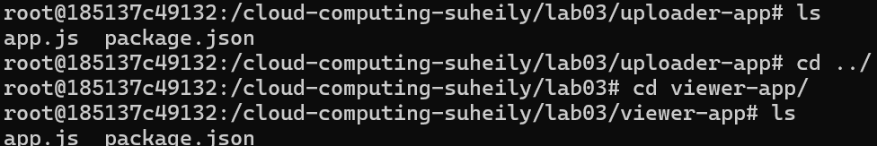

## Successful Uploader Page
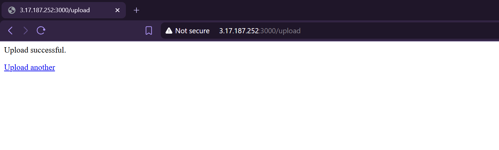

## Uploader file too large error output
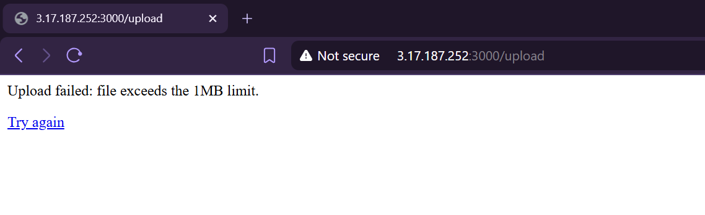

## Uploader non txt file error output
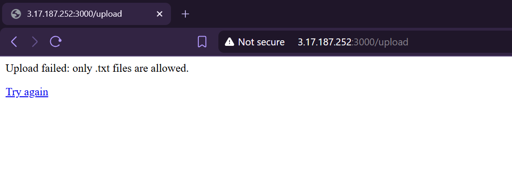

## Viewer page displaying the uploaded file’s content
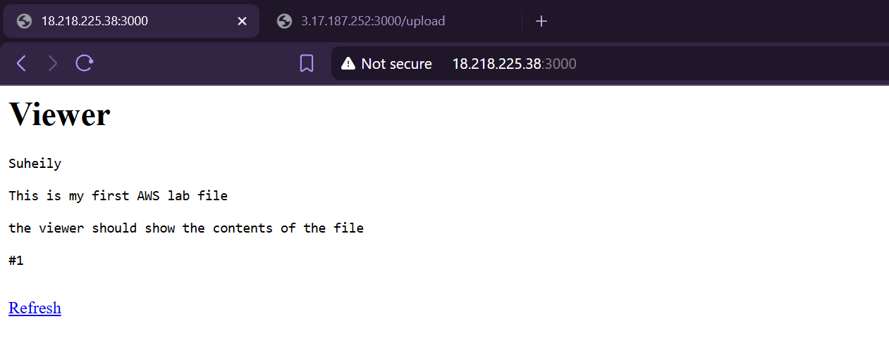

## Viewer page second file upload output
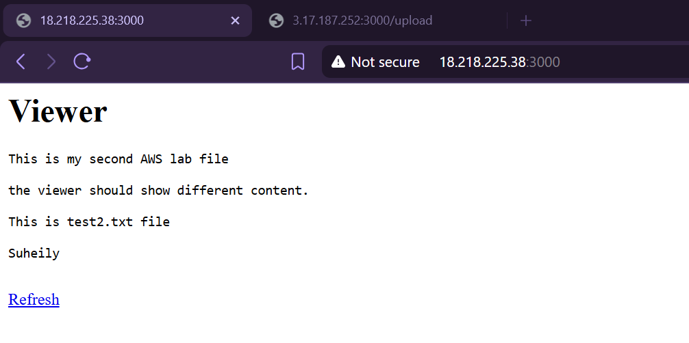

## aws ec2 describe-launch-templates showing both templates 
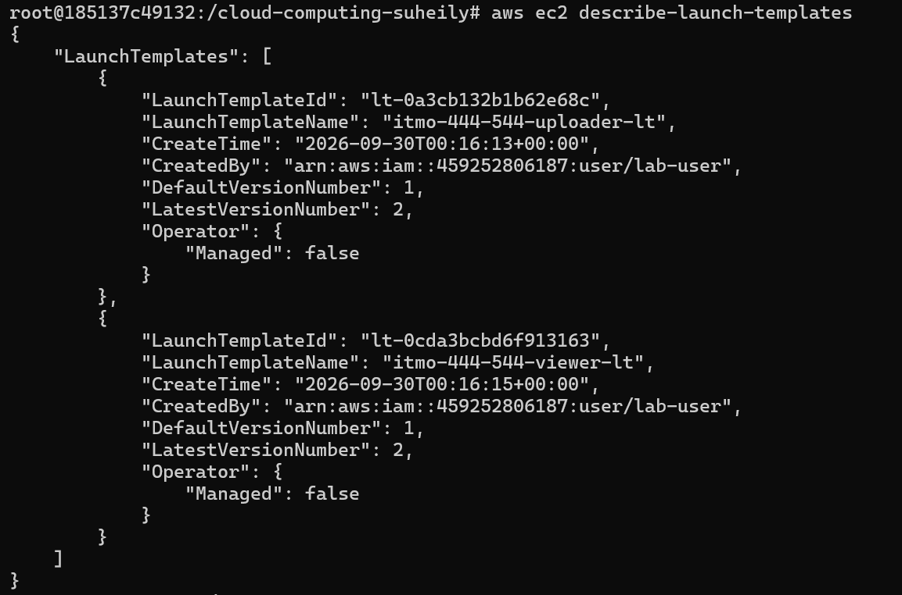

## aws ec2 describe-launch-template-versions --launch-template-name <uploader-lt-name> after re-running the create script twice

## aws iam get-role-policy output 
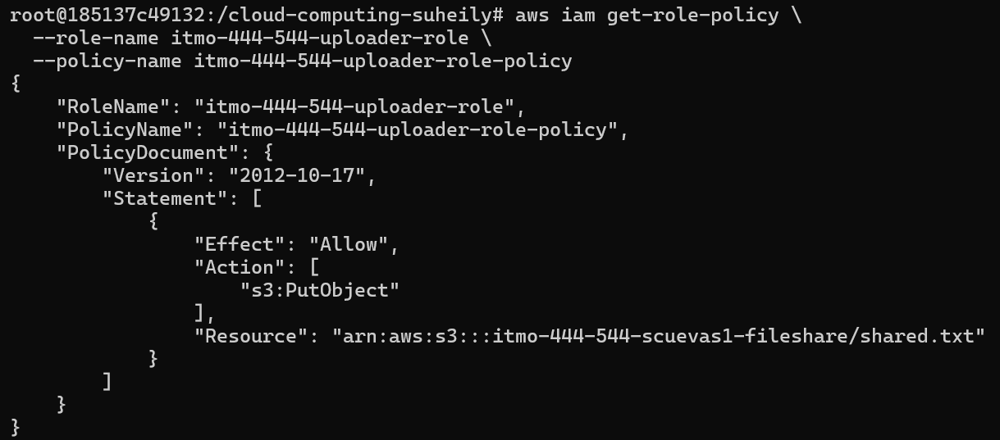

## create_app_stack.sh output 
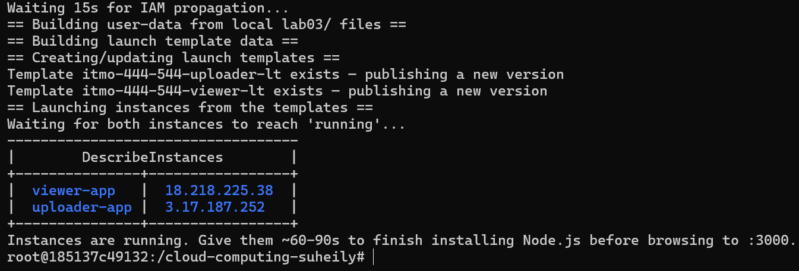

## delete_app_stack.sh output
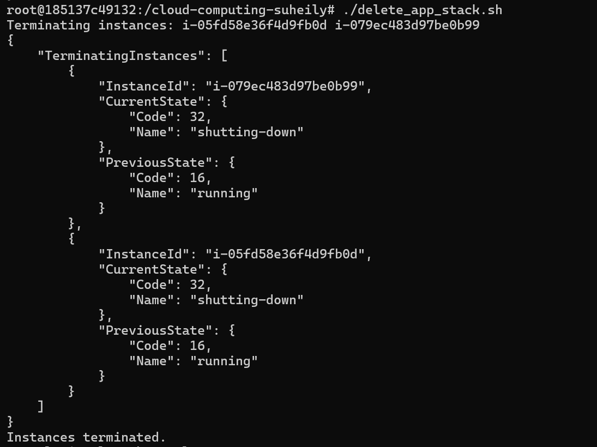
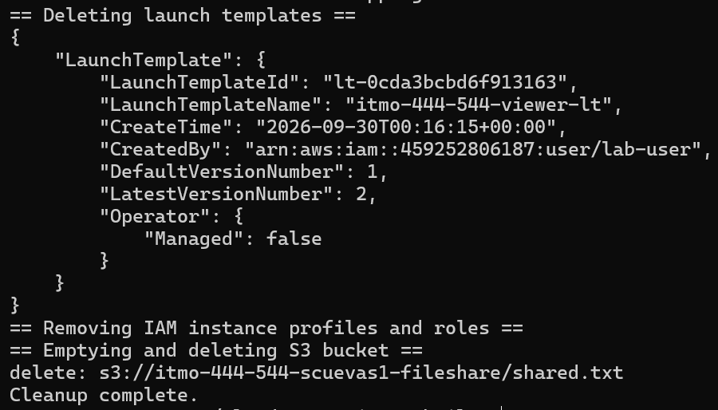

## why the uploader and viewer use separate IAM roles instead of one shared role with both permissions

The uploader and viewer use separate IAM roles instead of one shared role with both permissions because they each have a different job. The uploader's job is to send the file to S3 and the viewer's job is to grab that file and display it. The viewer doesn't need the same permissions to upload or change anything and vice versa. So if there is an issue with the viewer, keeping the roles separate means it won't have permission to overwrite the file in S3, even if someone gains unauthorized access to it.

## why embedding code directly into user-data means the instance never needs a Git or S3 credential just to fetch its own code

Embedding code directly into user-data means the instance never needs a Git or S3 credential just to fetch its own code because the code is already included in the launch configuration. When the EC2 instance starts up, it can create the application files directly from that code instead of having to download them from somewhere else. Because of this, you don't need any extra credentials just to access the code.