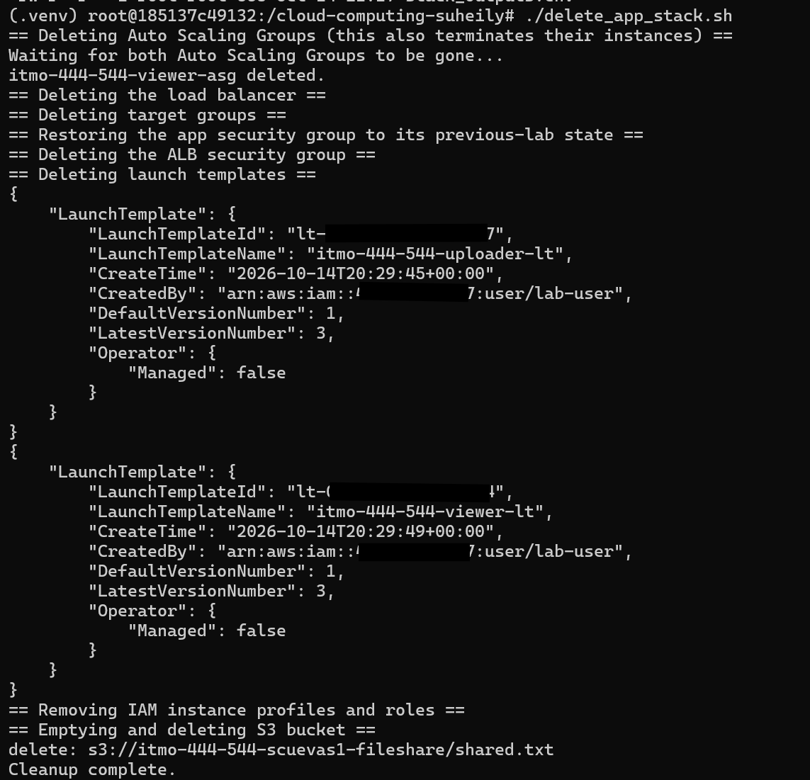

# EC2 S3 TwoTier FileUpload Display

## create_app_stack.sh output 

## Successful Uploader Page

## Successful Viewer Page

## Screenshot of aws elbv2 describe target health

## CSV poll log and console output run that passed
https://github.com/scuevas1/cloud-computing-suheily/blob/main/testing/chaos_test_pass.csv

https://github.com/scuevas1/cloud-computing-suheily/blob/main/testing/chaos_test_passed_results.txt

## CSV poll log and console output from a run that failed
https://github.com/scuevas1/cloud-computing-suheily/blob/main/testing/chaos_test_failed.csv

https://github.com/scuevas1/cloud-computing-suheily/blob/main/testing/chaos_test_failed_results.txt

## using your own recovery-time numbers, what dominates the recovery window (health-check timing vs. boot/ npm install time vs. something else)

## what changed in create_app_stack.sh / delete_app_stack.sh between the previous lab and this one

## delete_app_stack.sh output

