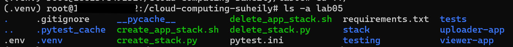
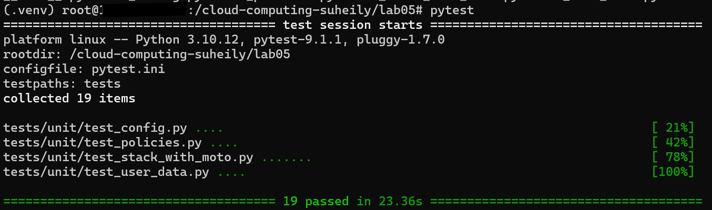
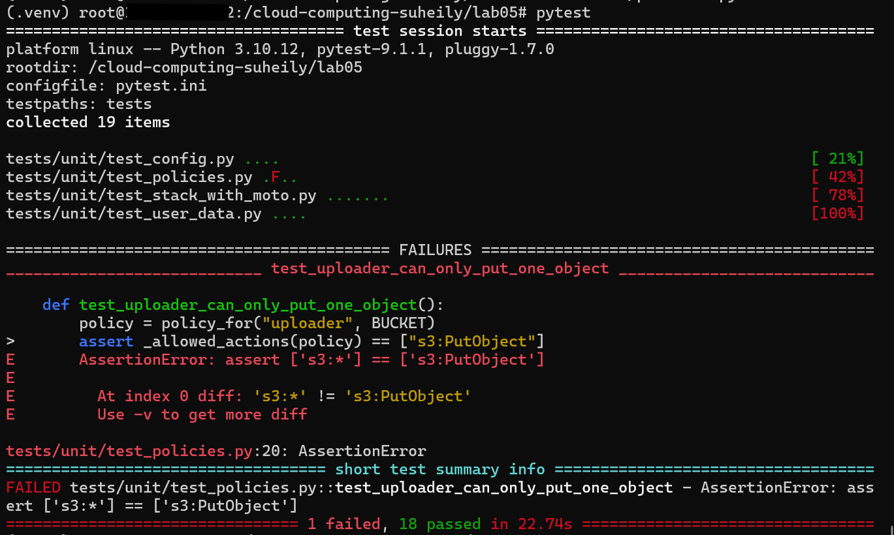
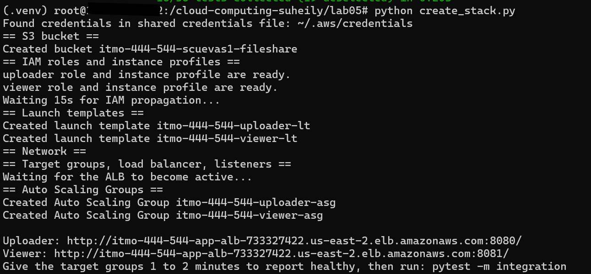
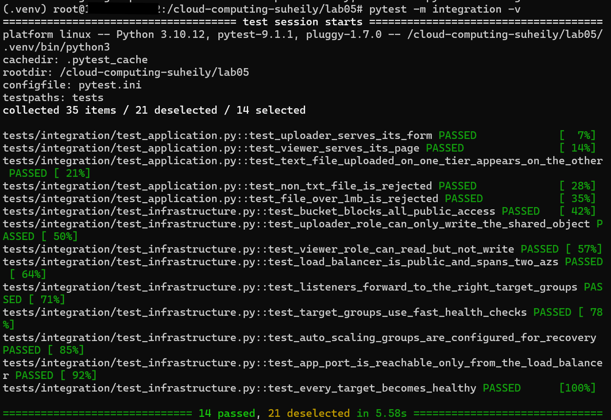
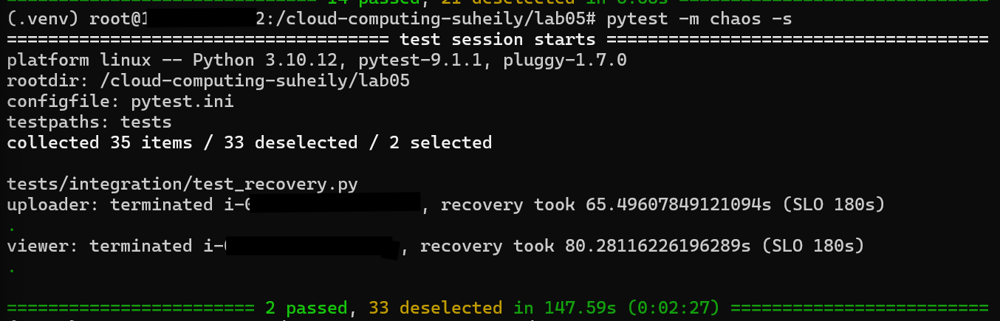
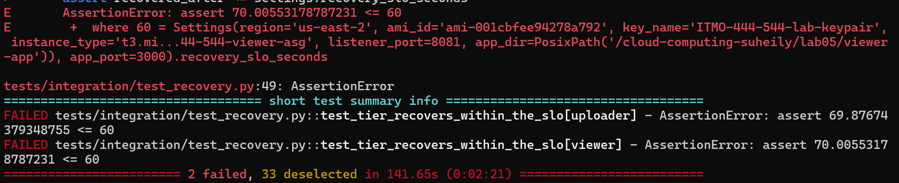
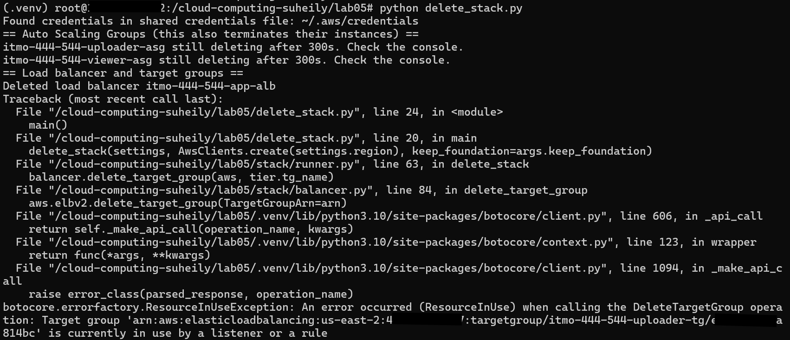
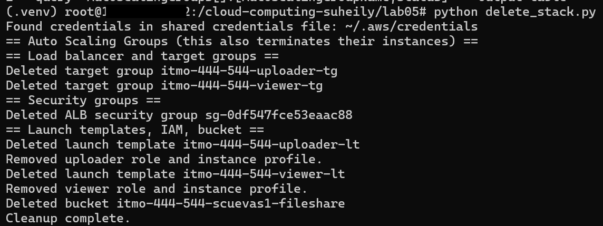

# EC2 S3 TwoTier FileUpload Display

## ls -a lab05 output 

## Screenshot of pytest

## Screenshot of "break it on purpose" experiment

## Screenshot of python create_stack.py completing

## Screenshot of pytest -m integration -v

## Screenshot of pytest -m chaos -s output

## Screenshot of pytest -m chaos -s fail output

## python delete_stack.py output #1

## python delete_stack.py output #2 (no errors)

