# Lab 07 — Terraform Weather Advisor

**Course:** ITMO 544 — Cloud Computing 

**Name:** Suheily Cuevas

## 1. Terraform installation and AWS identity
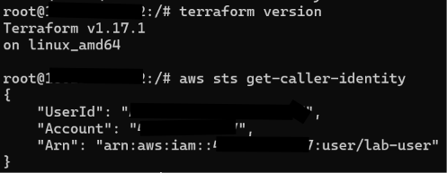

## 2. Part A — First Terraform experiment

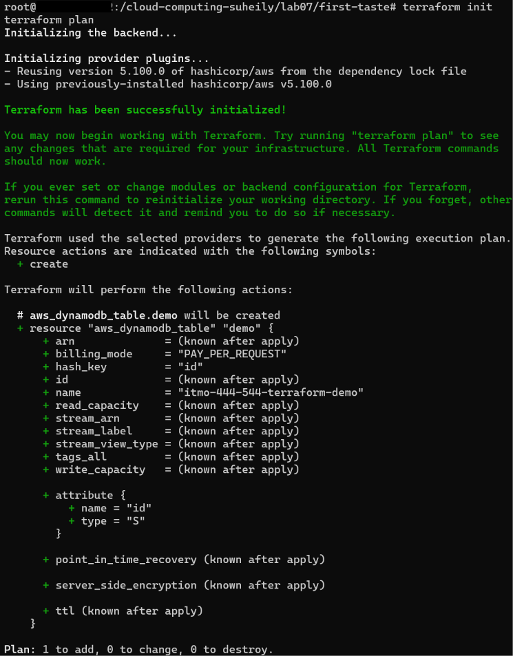
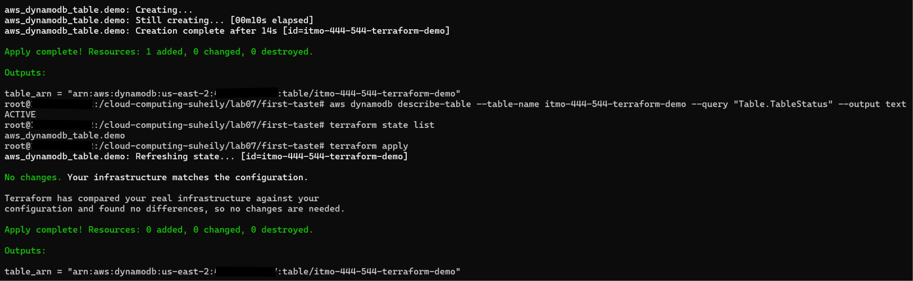
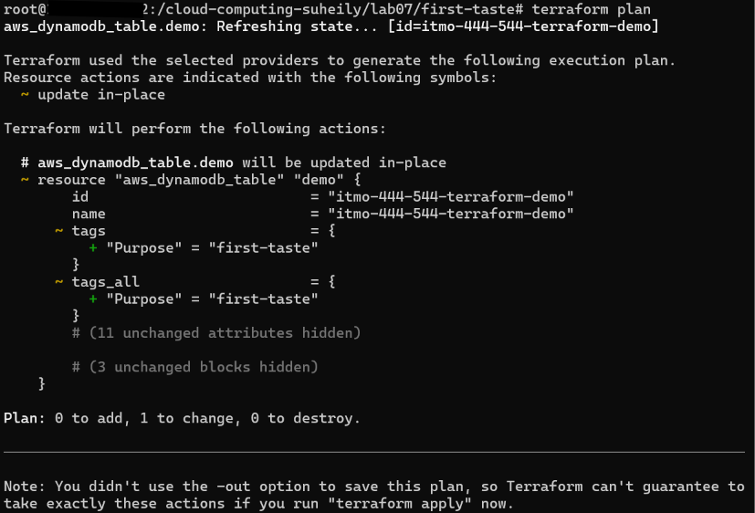
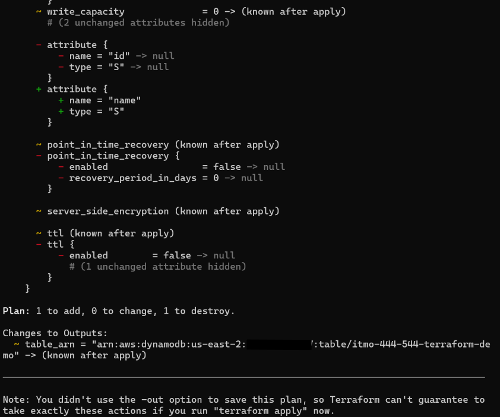

The -/+ symbol is the one to be careful about because if the resource has important data, it can end up being lost when it's destroyed.

## 3. Terraform formatting, validation, and deployment plan

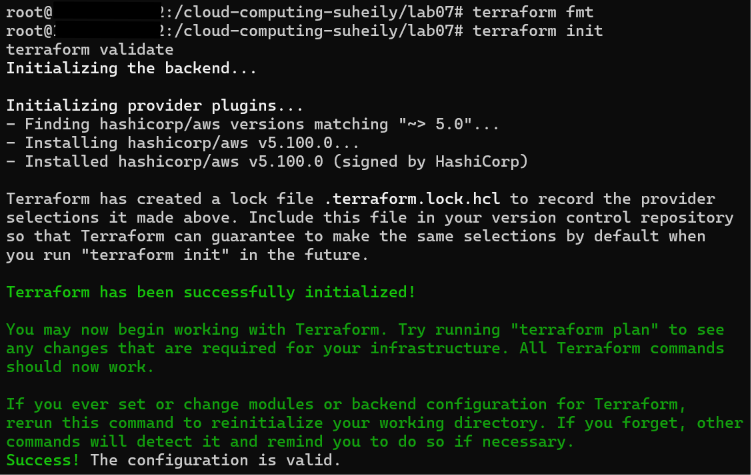
(screenshots/terraform-fmt-validate-ss2.png)
(screenshots/terraform-fmt-validate-ss3.png)

## 4. App smoke test and Weather Advisor page

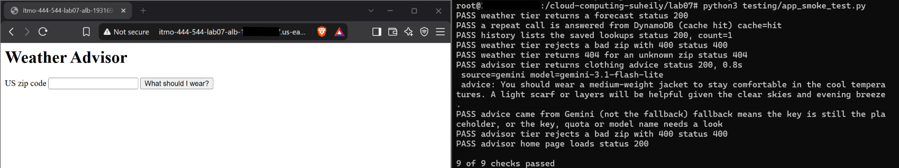

## 5. Part F, Steps 1–3 — Effort, dependencies, and idempotence

### Step 1: Code line counts
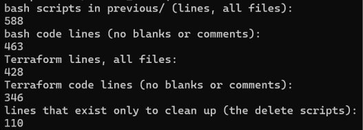

| Measurement | Lab06 Bash | Lab07 Terraform |
|:---|---:|---:|
| Lines to create the stack | 478 | 428 |
| Lines to delete the stack | 110 | 0 |
| Steps ordered manually | Several | 0 |
| Helper functions written | Multiple | 0 |
| Retry or wait loops written | Several | 0 |

Terraform made things easier because I didn't have to worry about creating resources in the right order or writing separate scripts to delete everything. It also saved me time because Terraform automatically checked for changes and handled updating resources instead of me having to do it manually.

### Step 2: Terraform dependency graph
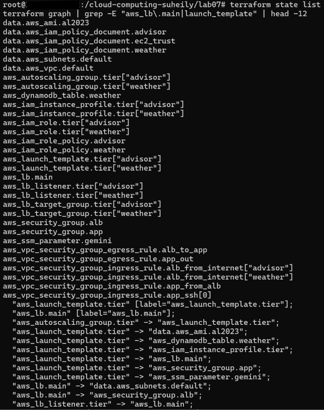

If I removed the WEATHER_URL line from compute.tf, terraform wouldn't know to create the load balancer before the advisor launch template, so the order could change and the advisor wouldn't know where to get the weather information.

### Step 3: Repeat plan
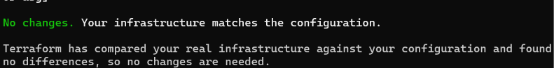

In Lab06, the Bash script would just check if the resources already existed and skip them, while Terraform checks if everything matches the configuration and catches changes that the Bash script wouldn't notice.

## 6. Part F, Steps 4–5 — Instance refresh and drift

### Step 4: Change the weather cache setting

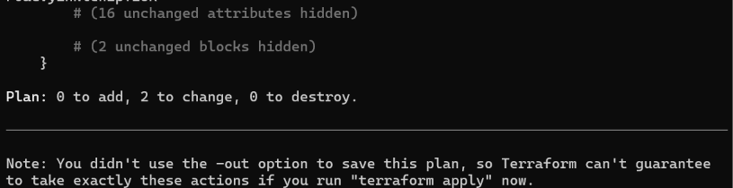
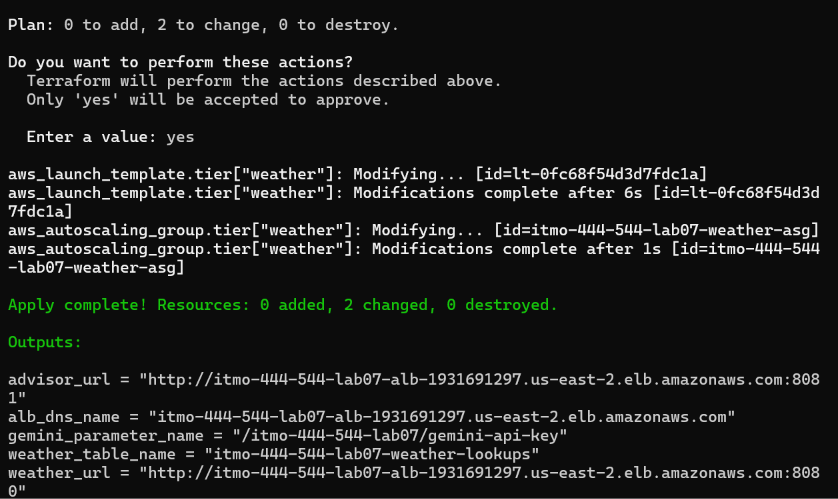
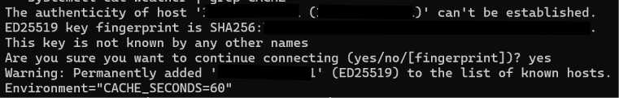

In Lab07, it took one apply command after changing the cache setting, but in Lab06 it took three commands after editing the .env file because I had to run the create script, find the instance and terminate it myself.

### Step 5: Detect and repair drift

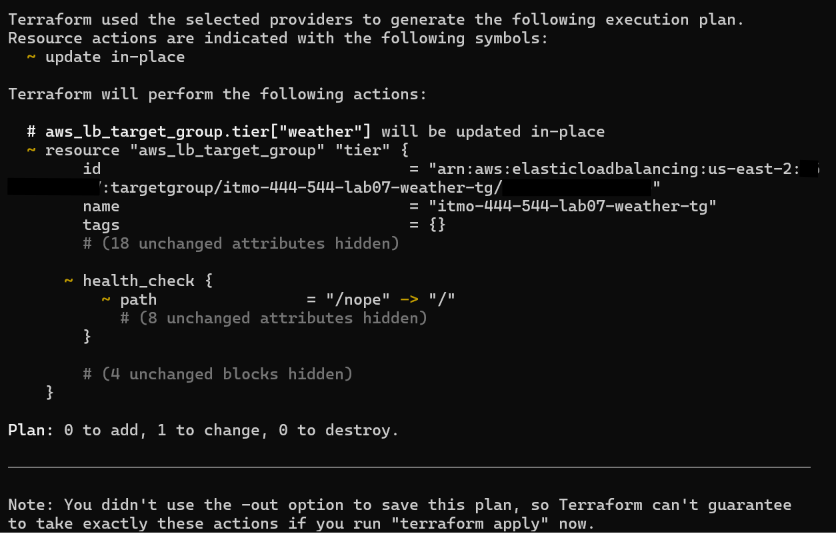
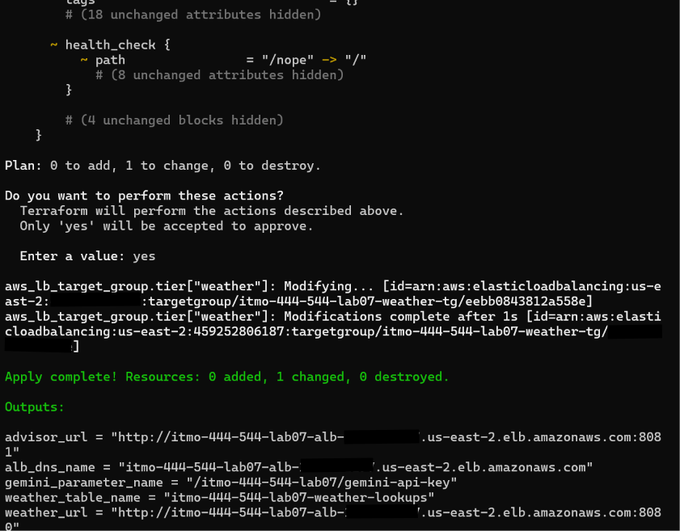
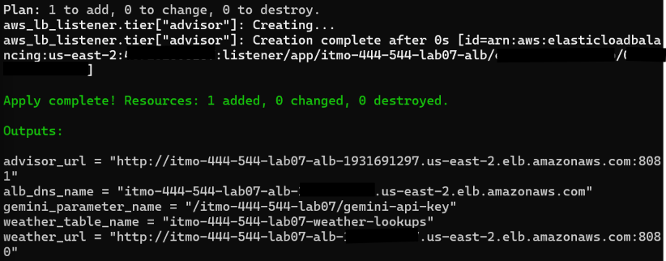

In Lab06, the script would just check if the target group already existed and skip it, but terraform noticed that I changed health check path to /nope and showed that it needed to be changed back to /.

## 7. Part F, Steps 6–7 — IAM and state

### Step 6: Least privilege
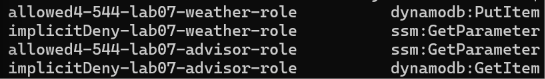

If an attacker took over the advisor tier they could access the Gemini API key from Parameter Store, but they wouldn't have permission to access the weather tier's DynamoDB table.

### Step 7: Gemini key and Terraform state
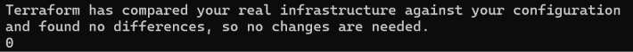

If I removed ignore_changes, the next terraform apply would replace my real Gemini API key with not-set-yet because that's what's written in the configuration. The terraform state would then have the placeholder instead of my real key, and Gemini wouldn't work anymore.

## 8. Part F, Steps 8–9 — Fallback and Lambda

### Step 8: Invalid Gemini key test
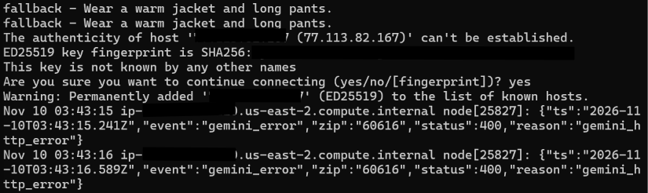

The problem is that users might think that everything is working fine even when Gemini isn't working, and if nobody checks the logs, the issue could go unnoticed for a long time.

### Step 9: Lambda exercise

#### 1. List every resource in compute.tf, iam.tf, network.tf and alb.tf that exists only because the advisor runs on an EC2 instance.

The advisor's launch template, Auto Scaling Group, and IAM instance profile wouldn't be needed. The advisor's EC2 health checks and instance refresh would also be removed, and its target group would need to be replaced.

#### 2. List what would stay (the parameter, the policy, the listener, the load balancer, and so on)

The load balancer, advisor listener, Gemini parameter, and IAM policy would stay. The weather tier would also stay the same, including its EC2 setup, security group, and DynamoDB table.

#### 3. List what would be new (a function resource, a permission that lets the load balancer call it, and the work of changing the code to handle a Lambda event).

I would need a Lambda function, a lambda target group, and permission for the load balancer to call it. I would also need to change the advisor code to handle Lambda events.

#### 4. For each of your three lists, say whether Terraform or Lambda removed the effort. What did you gain, and what new problem did you take on (think: cold starts, time limits, how you would test it)?

Lambda would handle running and scaling the advisor, while Terraform would still manage the infrastructure and new resources. This would reduce the work of managing EC2, but I would still have to deal with cold starts, time limits, and testing Lambda requests.

| Advisor on EC2 (this lab) | Advisor on Lambda | Effort moved to |
| :--- | :--- | :--- |
| Launch template and user-data | Replaced with a Lambda function, so I wouldn't need a launch template anymore. | Lambda runs the code, while Terraform creates the function. |
| Auto Scaling Group and instance refresh | Not needed because Lambda handles scaling automatically. | AWS Lambda |
| App security group rule for port 3000 | The advisor wouldn't need this since Lambda wouldn't use port 3000. The weather tier would still need the rule. | AWS Lambda |
| Instance profile and role | The instance profile wouldn't be needed, but Lambda would still need an IAM role. | Terraform sets up the role, and Lambda uses it. |
| Node.js install and systemd service | I wouldn't need to install Node.js or set up systemd because Lambda provides the runtime. | AWS Lambda |
| Health check and grace period | The advisor wouldn't need these because it wouldn't run on EC2 anymore. | AWS Lambda |

## 9. Written answers and review questions
1. How Terraform is like AWS Lambda and where the comparison stops

Terraform and AWS Lambda are similar because they both take care of things that I would normally have to do manually. Terraform figures out what resources need to be created and in what order, while Lambda handles running and scaling the application without me having to manage the servers. The biggest difference is that Terraform is used to set up and manage the infrastructure, while Lambda actually runs the code whenever it's triggered.

2. What Terraform did not make easier

Terraform didn't make the amount of code shorter since I still had to write a bunch of configuration files to get everything working. I also had to use the different Terraform commands and understand how the state file works. Even though setting everything up still took some effort, Terraform made it easier to keep track of changed, update resources, and clean everything up when I was finished.

## 10. Part F, Step 10 — Destroy and cleanup

My total runtime from this lab was approximately 3 hours (7:00pm to 10:01pm). Based on the estimated cost of $0.07 per hour, my total cost was around $0.21. After finishing the lab, I ran terraform destroy, but my laptop restarted during the first attempt, so I had to run it again. The final destroy removed 15 resources, and I used the AWS verification commands to make sure nothing from Lab07 was left running.

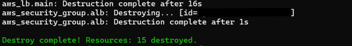
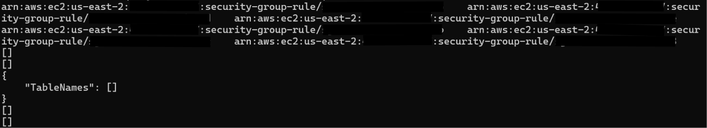